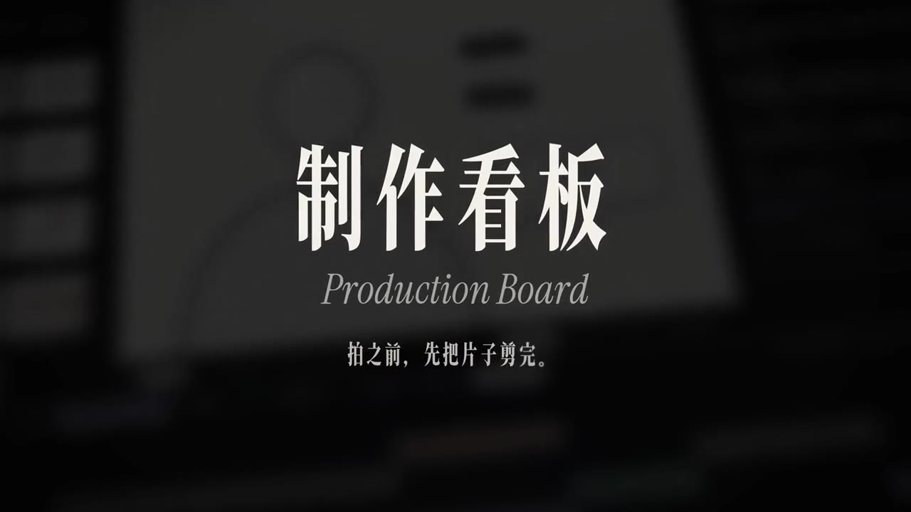
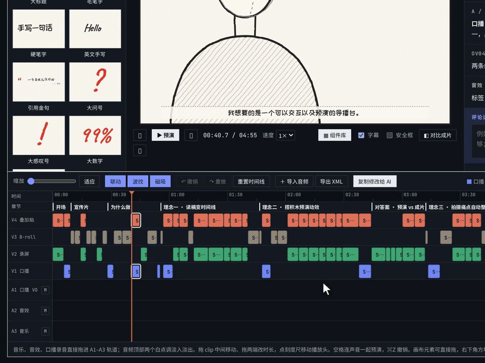
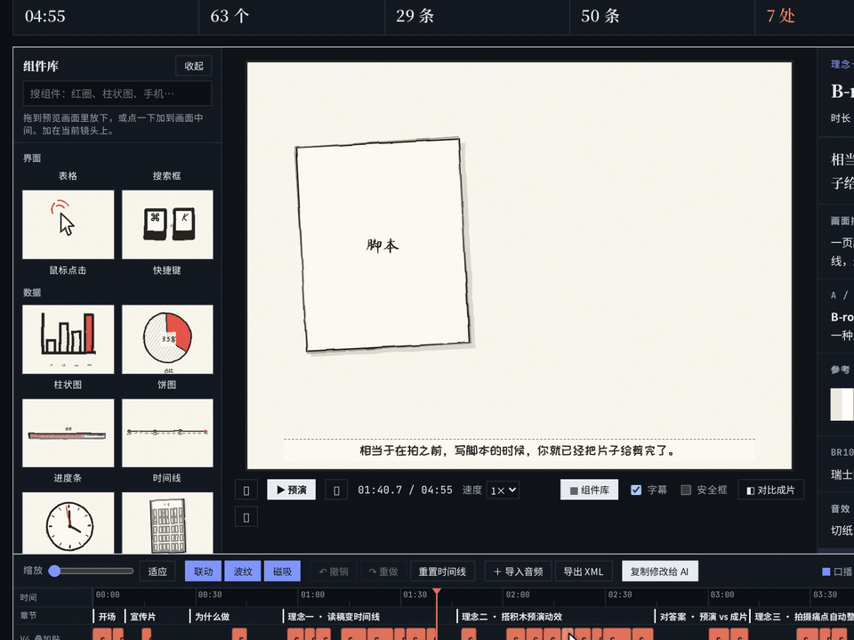
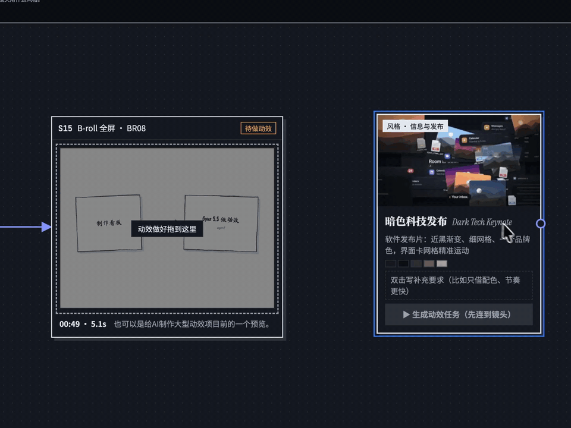
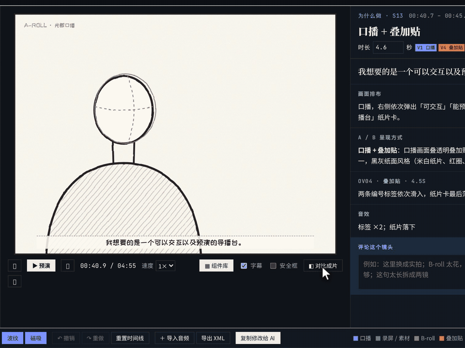
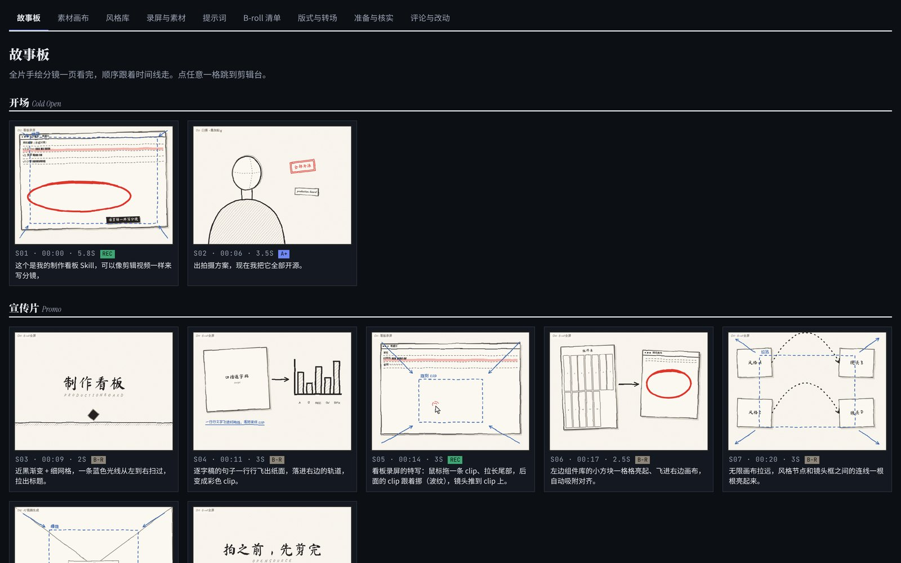
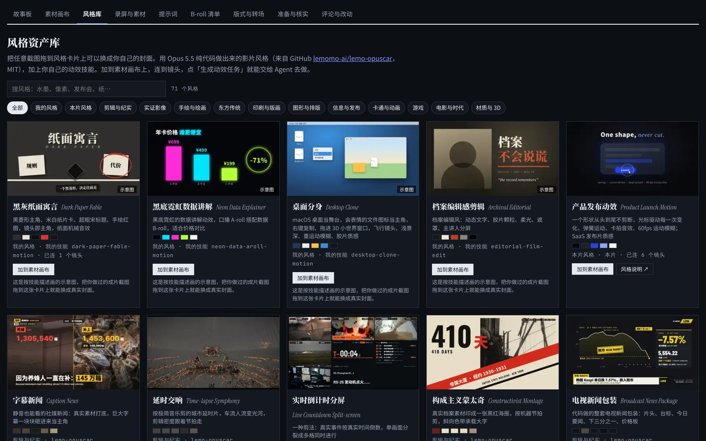
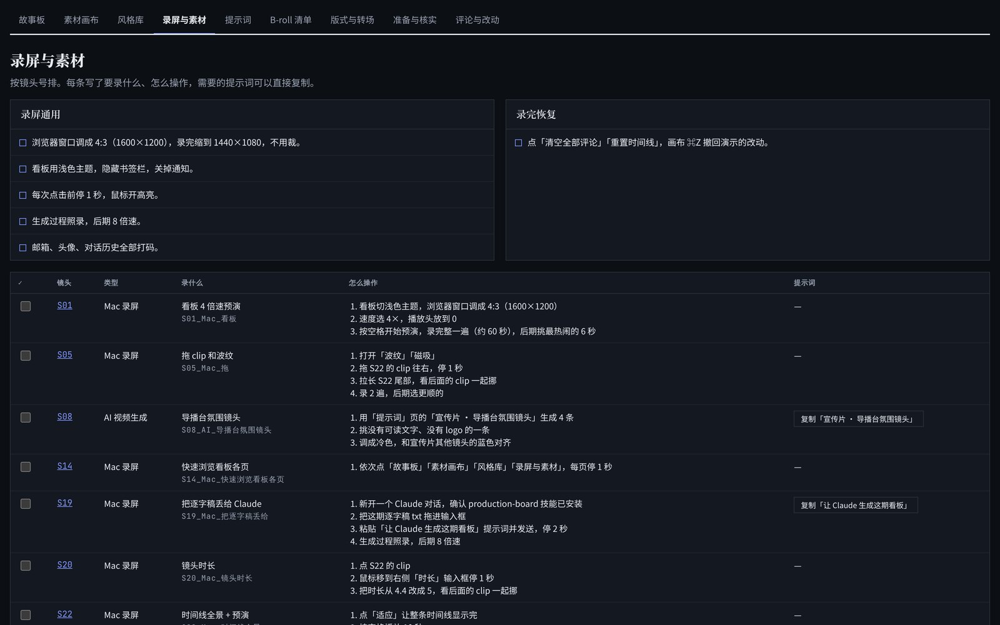
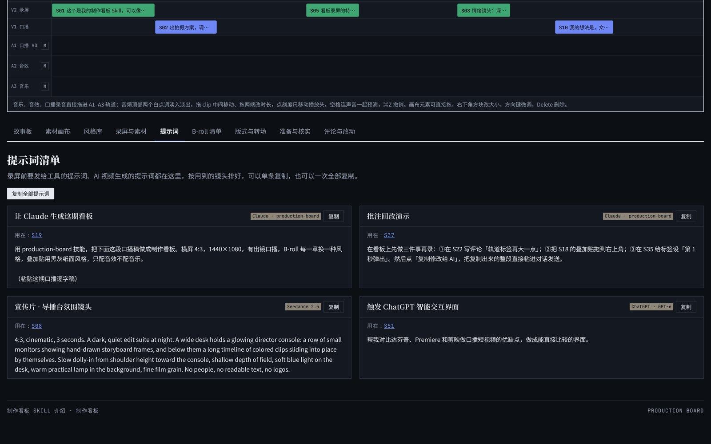

<div align="center">



# Production Board · 制作看板

**Cut the film before you shoot it.**

A Claude Skill that turns a voice-over script into a video production board you can play back and edit by hand. The result is a single HTML file.

[Live demo](https://guangjun5952.github.io/production-board/demo/) · [Project page](https://guangjun5952.github.io/production-board/) · [Download the Skill](docs/assets/production-board-skill.zip) · [中文](README.md)

  

</div>

---

## Why

However good a written shot list is, it's hard to play it back in your head before the shoot. And what an AI usually hands you is a pile of tables and documents you won't finish reading, let alone edit.

Production Board lays the script straight onto an editing timeline: how long each shot runs, what's on screen, which parts are screen recordings, live footage or overlays. Press space to preview the whole thing, drag and fix what feels wrong, leave notes, and send every change back to the agent in one click.

## What it does

### Edit desk: a timeline that behaves like an NLE

A hand-drawn storyboard preview on top; four video tracks (A-roll / screen / B-roll / overlay) and three audio tracks (VO / SFX / music) below. Shot lengths are estimated from speaking rate. Drag clips, trim both ends, with link, ripple, snap and undo. Drop in music, sound effects or your VO recording and play the whole cut with sound.



### Preview canvas: block out the motion

60+ built-in components (titles, callouts, cards, UI, charts, people and camera marks). Drag them from the library onto the canvas, move, resize, and set when and how each one enters, so the motion-design agent knows exactly what appears where and when.



### Asset canvas: wire styles to shots, hand off to an agent

An infinite canvas. Shots that need a screen recording, a live shoot or stock footage get a frame; drop the finished video in and it's placed. The style library holds 66 film styles made in pure code with Opus 5.5. Drag a style onto the canvas, connect it to shots, press "Generate motion task", and you get a ready-to-send brief for the agent.



### Compare with the final cut

Import your finished edit and wipe between the preview and the real thing with a slider, a brush or a circular mask, to check that framing and timing line up.



### And more

| | |
|---|---|
|  |  |
| **Storyboard**: every shot, by chapter | **Style library**: 66 film styles plus your own |
|  |  |
| **Recording & asset lists**: what to capture and how | **Prompts**: video-generation and motion prompts in one place |

- **Notes and revisions**: comment on any shot, copy all changes for the AI in one click; the agent revises in bulk and keeps a changelog.
- **XML export**: export FCP 7 XML for Premiere or DaVinci Resolve.
- **Light / dark themes**, full-screen, and preview-only full-screen for clean screen recordings.

> The board UI and the Skill instructions are currently in Chinese. Claude follows them fine with English scripts, and the board itself works the same.

## Quick start

1. Download [`production-board-skill.zip`](docs/assets/production-board-skill.zip).
2. Install it in Claude:
   - **Claude on the web / desktop**: find Skills in settings and upload the zip.
   - **Claude Code**: copy `skill/production-board` to `~/.claude/skills/production-board`.
3. Give Claude your voice-over script and ask for a production board. It asks a few questions first (aspect ratio, on-camera or not, B-roll style, footage), then builds the board.

> Other agents that can write and open HTML can use it too: pass `SKILL.md` as the prompt.

### Build or revise by hand

All of a board's content lives in one `BOARD` data block that you can pull out, edit and put back:

```bash
python3 skill/production-board/scripts/build_board.py --extract examples/intro-episode.html > board.js
python3 skill/production-board/scripts/build_board.py board.js my-board.html "My video board"
```

## Layout

```
skill/production-board/     The Skill: SKILL.md, board template, build script
examples/                   The full board for the video that introduces this project
docs/                       Project page (GitHub Pages), live demo, screenshots
```

## Credits

- The 66 film styles and their covers in the style library come from [lemomo-ai/lemo-opuscar](https://github.com/lemomo-ai/lemo-opuscar) (MIT License, Copyright (c) 2026 LemoLab). Full license text in [THIRD_PARTY_NOTICES.md](THIRD_PARTY_NOTICES.md).

## License

[MIT](LICENSE)
