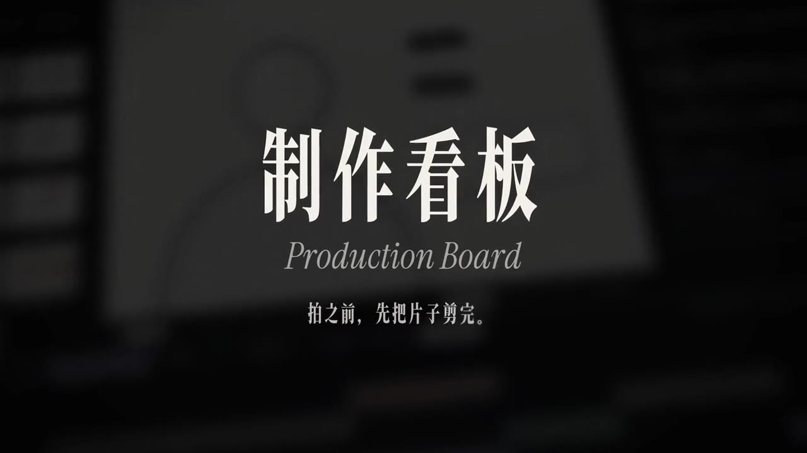
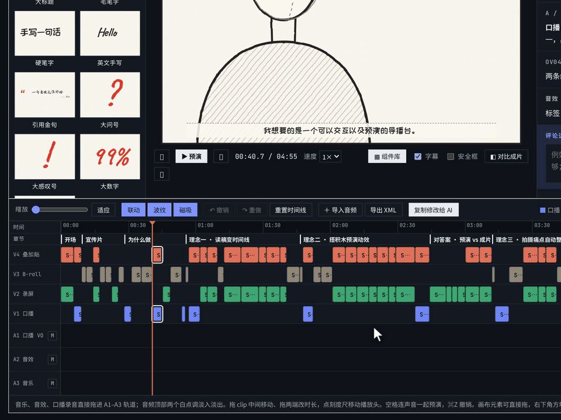
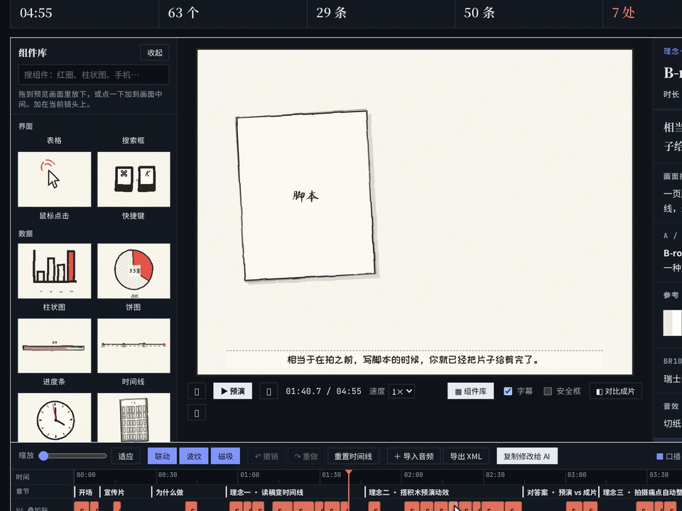
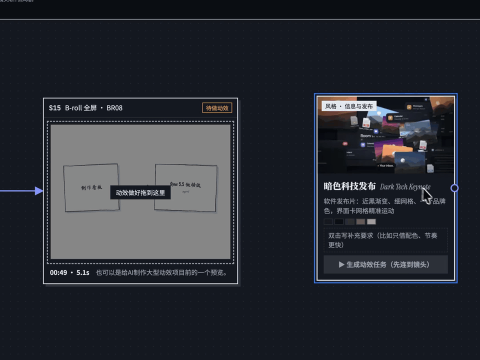
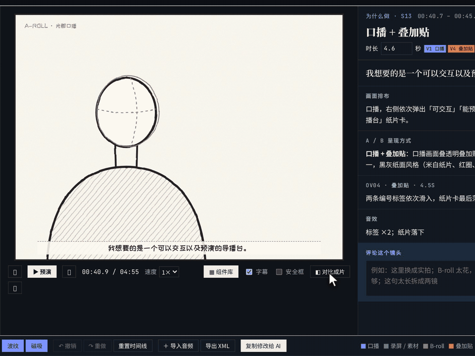
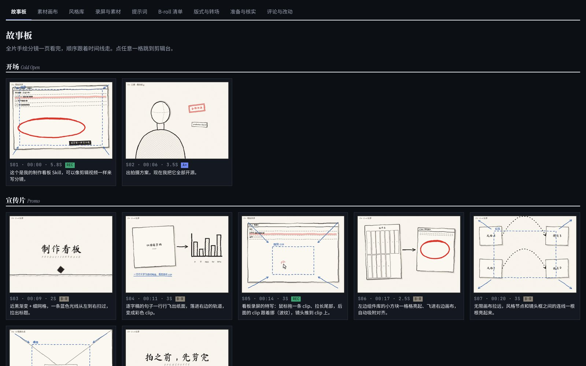
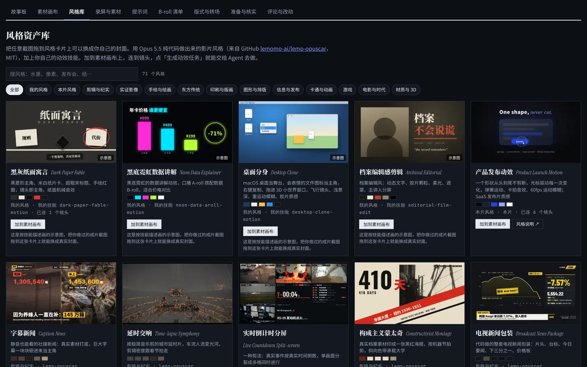
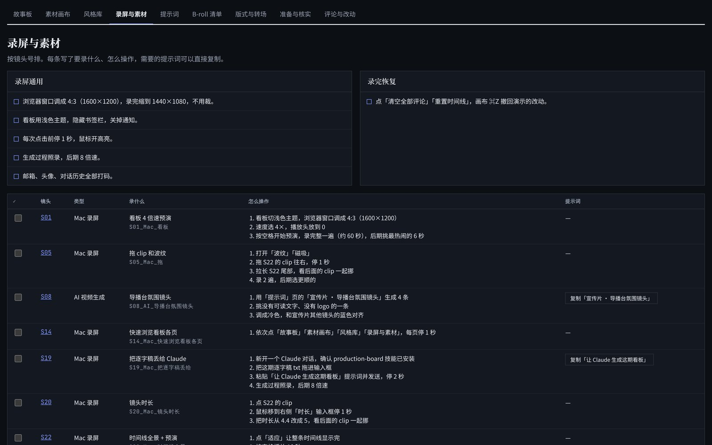
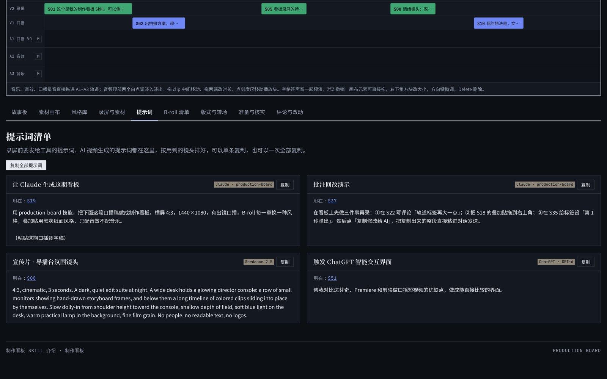

<div align="center">



# 制作看板 · Production Board

**拍之前，先把片子剪完。**

一个 Claude Skill：把口播逐字稿变成一个能预演、能直接动手改的视频制作看板。成品是一个单独的 HTML 文件。

[在线体验](https://guangjun5952.github.io/production-board/demo/) · [项目主页](https://guangjun5952.github.io/production-board/) · [下载 Skill](docs/assets/production-board-skill.zip) · [English](README.en.md)

  

</div>

---

## 为什么做这个

文字分镜写得再好，拍之前也很难在脑子里把它播一遍。AI 交过来的通常是一大堆表格和文档，看不完，也没法动手改。

制作看板把逐字稿直接排成一条剪辑时间线：每个镜头多长、用什么画面、哪里要录屏、哪里要实拍、哪里叠贴纸，打开就能按空格从头预演一遍，觉得不对就直接拖、直接改、直接批注，再一键把修改交回给 Agent。

## 它能做什么

### 剪辑台：像剪辑软件一样的时间线

上面是手绘分镜风格的预览画布，下面是四条画面轨（口播 / 录屏 / B-roll / 叠加贴）和三条音频轨（口播 VO / 音效 / 音乐）。镜头时长按语速自动算好。clip 可以拖动、拖两端改时长，有联动、波纹、磁吸和撤销。音乐、音效、口播录音直接拖进来，按空格带声音整片预演。



### 预览画布：搭积木一样预演动效

内置 60 多个画面组件（标题、标注、卡片、界面、数据图、人物与镜头……），从组件库拖进画布就能摆位置、改大小、设出现时间和入场方式。做动效的 Agent 能照着看到每个元素该从哪里、什么时候出现。



### 素材画布：风格连到镜头，一键交给 Agent

一张无限画布。要录屏、实拍、找素材的镜头先框好位置，拍完把视频拖进框就到位。风格资产库里有 66 种用 Opus 5.5 纯代码做的影片风格，拖到画布上，连线到镜头，点「生成动效任务」，就把风格说明和对应镜头整理成一份任务交给 Agent。



### 对比成片：拍完回来对答案

成片剪完后导入看板，用滑杆、橡皮擦或圆形蒙版把预演和成片擦开对比，看位置、节奏对不对得上。



### 还有这些

| | |
|---|---|
|  |  |
| **故事板**：所有镜头按章节铺开 | **风格资产库**：66 种影片风格 + 自定义风格 |
|  |  |
| **录屏与素材清单**：要录什么、怎么录 | **提示词**：视频生成、动效任务的提示词集中放 |

- **评论与回改**：每个镜头都能写批注，所有改动一键「复制修改给 AI」，Agent 批量回改后生成新版本，修改记录保留。
- **导出 XML**：拍完回来导出 FCP 7 XML，可在 Premiere、达芬奇里打开。
- **浅色 / 深色主题**、全屏、只把预览画面全屏方便录屏。

## 快速开始

1. 下载 [`production-board-skill.zip`](docs/assets/production-board-skill.zip)。
2. 安装到 Claude：
   - **Claude 网页 / 桌面版**：在设置里找到 Skills（技能），上传这个 zip。
   - **Claude Code**：把 `skill/production-board` 文件夹复制到 `~/.claude/skills/production-board`。
3. 把你的口播逐字稿丢给 Claude，说「做一个制作看板」。它会先问几个问题（画幅、要不要出镜、B-roll 风格、素材），然后生成看板。

> 也能用在其他可以生成并打开 HTML 的 Agent 里，把 `SKILL.md` 当作提示词给它即可。

### 手动生成或回改

看板的所有内容都在一个 `BOARD` 数据块里，可以单独拿出来改，再塞回模板：

```bash
# 从已有看板里取出数据
python3 skill/production-board/scripts/build_board.py --extract examples/intro-episode.html > board.js
# 改完 board.js 后重新生成
python3 skill/production-board/scripts/build_board.py board.js my-board.html "我的视频 制作看板"
```

## 目录

```
skill/production-board/     Skill 本体：SKILL.md、看板模板、生成脚本
examples/                   示例：介绍这个看板的那期视频的完整看板
docs/                       项目主页（GitHub Pages）、在线体验、截图和演示
```

## 致谢

- 风格资产库里的 66 种影片风格和封面来自 [lemomo-ai/lemo-opuscar](https://github.com/lemomo-ai/lemo-opuscar)（MIT License, Copyright (c) 2026 LemoLab），完整许可见 [THIRD_PARTY_NOTICES.md](THIRD_PARTY_NOTICES.md)。

## 许可

[MIT](LICENSE)
